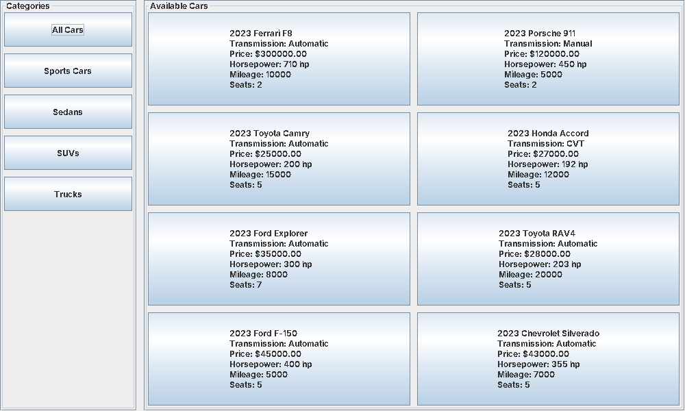
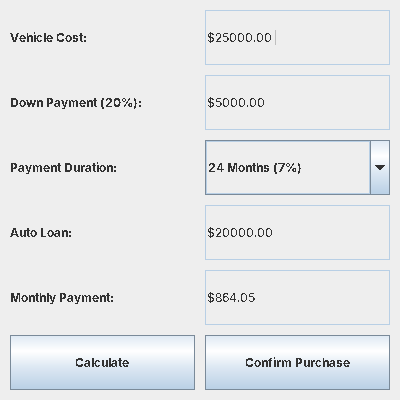
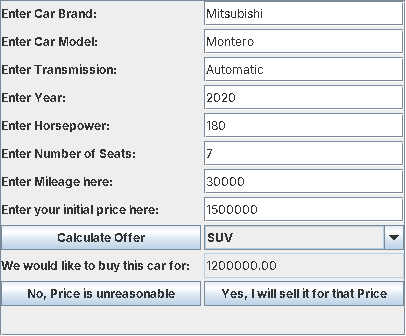

# OnlyCars — Vehicle Sales System

A Java w/GUI desktop app for a small car dealership. Customers can browse the inventory by category and buy a car with a loan calculator, or sell their own car and get an offer based on its mileage. Built as a group final project for an Object-Oriented Programming course at FEU Tech (November 2024).



## Features

- **Browse and buy:** filter the inventory by category (sports cars, sedans, SUVs, trucks) and pick a car.
- **Loan calculator:** 20% down payment, with 12-, 24- or 48-month payment plans and their interest rates.
- **Receipt:** collects the buyer's name, address and contact number, then shows a purchase receipt.
- **Sell a car:** enter a car's details and asking price; the app makes an offer discounted by mileage (5% to 30%), and adds the car to the inventory if you accept.
- **File-based inventory:** cars are stored in `Cars.txt` and saved after every purchase or sale. A default inventory is created on first run.

## Screenshots

| Loan calculator | Selling a car |
| --- | --- |
|  |  |

## Design

The vehicle types share an abstract `Car` base class:

```
Car (abstract)
├── SportsCar
├── Sedan
├── SUV
└── Truck   (adds a truck bed flag)
```

| Class | Role |
| --- | --- |
| `Main` | Entry point |
| `Options` | Main menu: Buy, Sell, Exit |
| `Buy` | Inventory browser, loan calculator and receipt |
| `Sell` | Sell form and mileage-based offer |
| `Car` and subclasses | Vehicle data, category matching and file format |

## Running it

Requires JDK 17 or later (the code uses switch expressions and text blocks).

```bash
javac -d out src/javafinals/finals/*.java
java -cp out javafinals.finals.Main
```

Run it from the repository root so the app finds `Cars.txt`.
